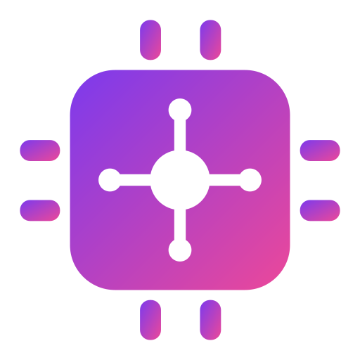
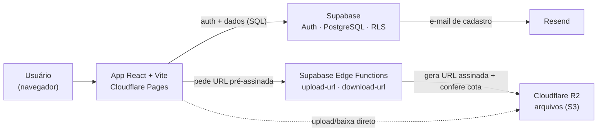

<div align="center">



# Central de Estudos

**Plataforma de estudos da Fatec Indaiatuba que se alimenta sozinha, com a Yara, uma IA local.**


</div>

---

## Sobre o projeto

A **Central de Estudos** é o PTG de Análise e Desenvolvimento de Sistemas da Fatec Indaiatuba. Hoje o aluno caça informação no site, em PDFs, no e-mail e na fala do professor, e copia tudo à mão. Na Central, a **Yara** lê o que a Fatec já publica (site da unidade, calendário acadêmico, grade de horários, editais, planos de ensino) e monta sozinha a agenda, os horários, as tarefas e os avisos de cada aluno, sempre mostrando a fonte.

Secretaria e coordenação não fazem nenhum trabalho extra. Quando a Yara não tem certeza, a própria turma confirma com votos visíveis.

## Funcionalidades

- **Agenda no padrão Outlook:** dia, semana, mês e lista; camadas por disciplina e da Fatec; arrastar e redimensionar; criação por frase; link .ics para o Outlook, Google ou iPhone.
- **Hoje:** resumo do dia da Yara, aulas, próximas provas e o que mudou.
- **Espaço pessoal:** matérias e materiais, caixa de entrada, tarefas (Kanban), plano de revisão até a prova, notas e faltas.
- **Comunidade:** turma com conversa, mural, materiais, dúvidas respondidas com fonte e **validação coletiva**.
- **Painel admin:** fontes monitoradas, curadoria da IA, contas e papéis, servidor.
- Cadastro só com e-mail institucional, confirmado por código. Interface clara (identidade **Foco**), responsiva e em português do Brasil.

## Stack utilizada

| Camada | Tecnologias |
|---|---|
| **Front-end** | React, Vite, TypeScript, Tailwind CSS v4, React Router, shadcn/ui, lucide-react. Previstos: FullCalendar (agenda), TanStack Query, dnd-kit |
| **Back-end** | Supabase — autenticação por código no e-mail institucional, API REST/Realtime e Edge Functions (Deno/TypeScript); Cloudflare R2 (armazenamento de arquivos, compatível com S3); Resend (e-mails) |
| **Banco de dados** | PostgreSQL (gerenciado pelo Supabase), com Row Level Security e busca full-text |
| **Infra / Deploy** | Cloudflare Pages (hospedagem com CI/CD); GitHub Actions (keep-alive) |

Todas as camadas rodam em planos gratuitos no lançamento. Os arquivos ficam no Cloudflare R2 desde o início (10 GB grátis, download sem custo), o que mantém a arquitetura pronta para escalar.

## Arquitetura



O navegador envia e baixa arquivos **direto do R2** por URLs pré-assinadas de validade curta, emitidas pelas Edge Functions só após checar a cota do usuário. Nenhuma credencial do R2 chega ao front-end. O diagrama detalhado está em [`docs/arquitetura.md`](docs/arquitetura.md).

## Estrutura de pastas

```
central-de-estudos/
├─ public/              # estáticos (_redirects para SPA, ícone do app)
├─ src/
│  ├─ api/              # adaptador de dados: entities.ts
│  ├─ components/       # layout (sidebar, trilho) e componentes do app
│  │  ├─ agenda/        # painel de calendários, minicalendário
│  │  ├─ foco/          # selos de origem, pílulas de evento
│  │  └─ ui/            # primitivos do shadcn/ui
│  ├─ lib/              # clientes e utilitários (supabase.ts, utils.ts)
│  ├─ pages/            # telas/rotas (auth/ para as telas públicas)
│  ├─ types/            # tipos TypeScript
│  ├─ index.css         # tokens da identidade Foco
│  ├─ App.tsx
│  └─ main.tsx
├─ docs/
│  ├─ arquitetura.md    # diagrama e documentação de arquitetura
│  └─ design/           # identidade Foco e mockups 01–26 (zip fora do git)
├─ .github/workflows/   # keep-alive (ping anti-pausa do Supabase)
├─ .env.example         # modelo das variáveis de ambiente
├─ CLAUDE.md            # briefing do projeto
├─ LICENSE
└─ README.md
```

Previstos: `supabase/functions` (upload no R2, hook de domínio, .ics) e `workers/yara/` (coletor + IA local).

## Como rodar localmente

Pré-requisitos: **Node.js LTS** e **Git**.

```bash
# 1. clonar o repositório
git clone https://github.com/<seu-usuario>/central-de-estudos.git
cd central-de-estudos

# 2. instalar as dependências
npm install

# 3. configurar o ambiente
cp .env.example .env.local
# preencha VITE_SUPABASE_URL e VITE_SUPABASE_ANON_KEY

# 4. rodar em desenvolvimento
npm run dev
```

O app sobe em `http://localhost:5173`.

## Roadmap

Fases 0 e 1 feitas (base visual e navegação). Próximas: 2 · Supabase e login por código → 3 · agenda e espaço pessoal → 4 · comunidade e validação coletiva → 5–6 · Yara → 7 · painel admin → 8 · piloto com a turma → 9 · avaliação do PTG. Detalhes em `CLAUDE.md`.

## Autor

**Lucas T. Strinta** — Análise e Desenvolvimento de Sistemas (FATEC).

## Licença

Distribuído sob a licença MIT. Veja `LICENSE` para mais detalhes.
