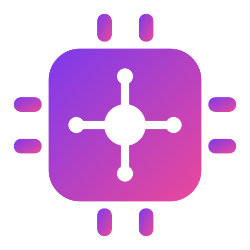
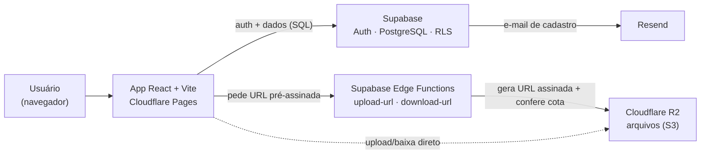

<div align="center">



# Central de Estudos

**Repositório pessoal para centralizar, organizar e encontrar rapidamente todo o material de estudo de cursos.**


</div>

---

## Sobre o projeto

A **Central de Estudos** é um aplicativo web para o estudante guardar e reencontrar tudo o que acumula ao longo de seus cursos: arquivos, links, anotações e trechos de código, organizados numa hierarquia **Curso → Semestre → Matéria → Material**. Cada usuário tem login próprio e seus dados são privados.

O projeto nasceu como protótipo numa plataforma no-code (Base44) e está sendo reconstruído com stack própria, de código aberto e sem custo de lançamento, visando evoluir para um produto com planos de armazenamento.

## Funcionalidades

- **Dashboard** com próximos prazos, favoritos, adicionados recentemente e progresso por matéria.
- **Materiais em 4 tipos:** arquivo (upload de PDF/slides/imagens), link, anotação e snippet de código com destaque de sintaxe.
- **Documentos conectados** no estilo Obsidian: editor rich text, wikilinks `[[ ]]` com autocomplete, backlinks e visão em grafo interativa.
- **Calendário de prazos** (provas, entregas e mais) e fila de **revisão** ("estudar depois" / "já revisei").
- **Busca global** full-text em português e **filtros combinados** por matéria, tipo e etiqueta.
- **Favoritos e etiquetas livres** em todo material e documento.
- Interface clara e colorida, responsiva e 100% em português do Brasil.

## Stack utilizada

| Camada | Tecnologias |
|---|---|
| **Front-end** | React, Vite, TypeScript, Tailwind CSS, shadcn/ui, Tiptap (editor), react-force-graph (grafo), FullCalendar (agenda) |
| **Back-end** | Supabase — autenticação (OAuth Google + e-mail), API REST/Realtime e Edge Functions (Deno/TypeScript); Cloudflare R2 (armazenamento de arquivos, compatível com S3); Resend (e-mails) |
| **Banco de dados** | PostgreSQL (gerenciado pelo Supabase), com Row Level Security e busca full-text |
| **Infra / Deploy** | Cloudflare Pages (hospedagem com CI/CD); GitHub Actions (keep-alive) |

Todas as camadas rodam em planos gratuitos no lançamento. Os arquivos ficam no Cloudflare R2 desde o início (10 GB grátis, download sem custo), o que mantém a arquitetura pronta para escalar.

## Arquitetura



O navegador envia e baixa arquivos **direto do R2** por URLs pré-assinadas de validade curta, emitidas pelas Edge Functions só após checar a cota do usuário. Nenhuma credencial do R2 chega ao front-end. O diagrama detalhado está em [`docs/arquitetura.md`](docs/arquitetura.md).

## Estrutura de pastas

```
central-de-estudos/
├─ public/              # estáticos (_redirects para SPA, ícone do app)
├─ src/
│  ├─ api/              # adaptador do "motor": entities.ts, upload.ts
│  ├─ assets/           # imagens e fontes
│  ├─ components/       # UI reutilizável (shadcn/ui)
│  ├─ features/         # por domínio: cursos, semestres, materias,
│  │                    #   materiais, documentos, calendario, biblioteca, revisar
│  ├─ hooks/            # hooks React
│  ├─ lib/              # clientes e utilitários (supabase.ts, utils)
│  ├─ pages/            # telas/rotas
│  ├─ styles/           # estilos globais e tema
│  ├─ types/            # tipos TypeScript
│  ├─ App.tsx
│  └─ main.tsx
├─ supabase/
│  ├─ migrations/       # schema SQL (tabelas, RLS, triggers)
│  └─ functions/        # Edge Functions do R2 (upload-url, confirmar-upload, download-url)
├─ docs/                # diagrama e documentação de arquitetura
├─ .github/workflows/   # keep-alive (ping anti-pausa do Supabase)
├─ .env.example         # modelo das variáveis de ambiente
├─ .gitignore
└─ README.md
```

## Como rodar localmente

Pré-requisitos: **Node.js LTS** e **Git**.

```bash
# 1. clonar o repositório
git clone https://github.com/<seu-usuario>/central-de-estudos.git
cd central-de-estudos

# 2. instalar as dependências
npm install

# 3. configurar o ambiente
cp .env.example .env.local
# preencha VITE_SUPABASE_URL e VITE_SUPABASE_ANON_KEY

# 4. rodar em desenvolvimento
npm run dev
```

O app sobe em `http://localhost:5173`.

## Roadmap

- **v1 — Free (atual):** stack gratuita, cota de 200 MB por usuário, arquivos no R2.
- **v2 — Planos pagos:** integração com Stripe (assinaturas + "GB extra"), Supabase Pro (backup e sem pausa), cotas por plano (Free 200 MB · Plus 5 GB · Pro 50 GB).
- **v3 — Mobile:** PWA instalável; app nativo (React Native/Expo) como trabalho futuro.

## Autor

**Lucas T. Strinta** — Análise e Desenvolvimento de Sistemas (FATEC).

## Licença

Distribuído sob a licença MIT. Veja `LICENSE` para mais detalhes.
