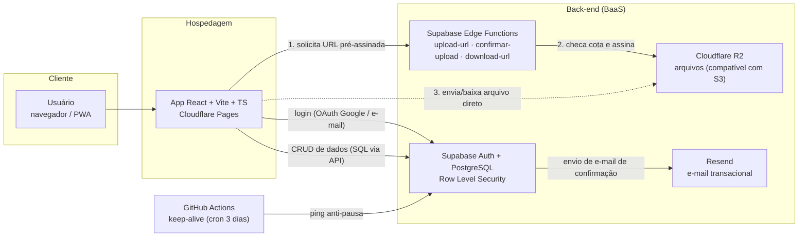
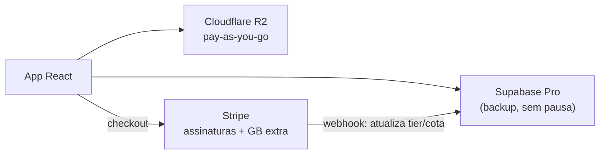

# Arquitetura — Central de Estudos

## Visão geral (versão Free)

O app é uma **SPA React** hospedada no **Cloudflare Pages**. O "back-end" é uma
composição de serviços gerenciados em plano gratuito: **Supabase** (autenticação,
banco PostgreSQL e Edge Functions), **Cloudflare R2** (armazenamento de arquivos) e
**Resend** (e-mails de cadastro).

### Princípios

- **Isolamento por usuário:** toda tabela tem `usuario_id` e RLS no PostgreSQL; cada
  conta só enxerga os próprios dados.
- **Upload seguro e com cota:** o front nunca recebe credenciais do R2. Ele pede uma
  **URL pré-assinada** à Edge Function, que só a emite após checar o limite por arquivo
  (25 MB) e a cota do usuário (200 MB no Free). O arquivo trafega **direto** entre o
  navegador e o R2 — barato (egress do R2 é gratuito) e sem sobrecarregar o servidor.
- **Custo de lançamento zero:** todos os serviços rodam em free tier.

## Evolução para planos pagos (v2)

A arquitetura **não muda** — apenas destrava limites e adiciona a camada de cobrança:

## Como recriar este diagrama no draw.io

1. Abra <https://app.diagrams.net> (draw.io).
2. Menu **Arrange → Insert → Advanced → Mermaid**.
3. Cole o bloco Mermaid "Visão geral" acima e confirme — o diagrama é gerado e fica editável.

(No Miro, use o app "Mermaid to diagram" ou monte as caixas manualmente a partir deste modelo.)
