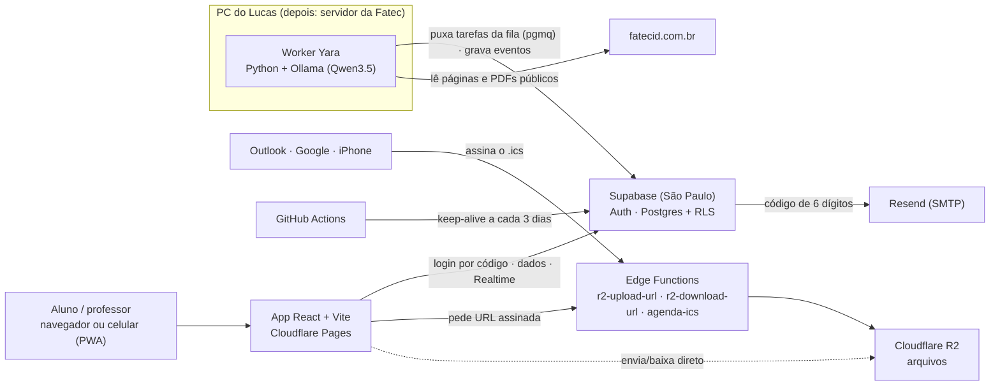

# Arquitetura — Central de Estudos

Híbrida: o app, o banco e os arquivos ficam na nuvem (acesso de qualquer lugar); a IA local (Yara) roda num PC com GPU e só faz conexões de saída.

## Peças

| Peça | O que faz |
|---|---|
| `src/` | SPA React 19 + TypeScript + Tailwind v4 (identidade Foco). Sem `.env.local` roda em modo demonstração. |
| `src/api/*` | Única camada que fala com o Supabase. Cada função tem a versão demonstração (`demo.ts`). |
| `supabase/migrations` | Schema, RLS e regras (domínio do e-mail, validação coletiva, aplicação das propostas). |
| `supabase/functions` | URLs assinadas do R2 e o feed `.ics` pessoal. |
| `workers/yara` (Fase 5) | Coletor + extração com IA local. Se parar, o app continua; as tarefas esperam na fila. |

## Segurança

- Cadastro só com e-mail de domínio permitido do tenant; o trigger `criar_perfil` recusa o resto.
- RLS em todas as tabelas: dados pessoais por `auth.uid()`, dados da turma só para quem está nela.
- O front nunca recebe a service role nem as chaves do R2. O `.ics` usa um token pessoal e secreto.
- A Central nunca pede nem guarda a senha do SIGA.

## Limites do plano gratuito (piloto)

Supabase Free (500 MB de banco, pausa após 7 dias sem uso → keep-alive), R2 (10 GB, download sem custo), Resend (100 e-mails/dia), Cloudflare Pages.
